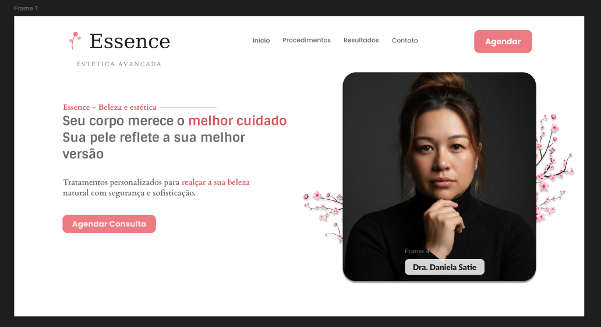

# Essence | Website Design

Projeto de UI/UX Design desenvolvido para uma
clínica de estética, com foco em elegância,
usabilidade e experiência do usuário.

## 🎨 Sobre o projeto

O objetivo foi desenvolver uma interface moderna,
minimalista e intuitiva para apresentar os
procedimentos estéticos e facilitar o contato
e agendamento de clientes.

## 🖥️ Preview do projeto

### Página de procedimentos

## 🎯 Processo de criação

- Definição da identidade visual.
- Escolha de cores e tipografia.
- Organização da arquitetura de informações.
- Criação dos wireframes.
- Desenvolvimento do protótipo de alta fidelidade.

## 🔗 Protótipo no Figma

[Visualizar projeto no Figma](https://www.figma.com/design/TaLYjBF8BRyPGveEFta9C9/Essence?node-id=0-1&p=f&t=nJdJZNFU2Vitwkl5-0)

---

Desenvolvido por Gabriela Higashi.
